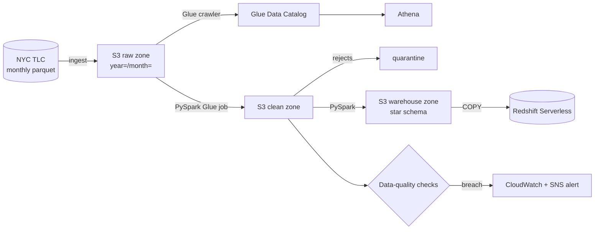

# NYC Taxi Data Lake on AWS

[](https://github.com/mohammadazam7/nyc-taxi-data-lake/actions/workflows/ci.yml)


[](LICENSE)

A batch pipeline that lands the public [NYC TLC trip records](https://www.nyc.gov/site/tlc/about/tlc-trip-record-data.page)
in an S3 data lake, cleans them with PySpark on AWS Glue, models a star schema in
Redshift Serverless, and alerts when data quality slips.

The same code runs on a laptop against local folders and in AWS against S3, so every
stage is testable without a cloud account.

> **Status:** under active development. Milestone 1 (ingest) is complete; see the
> [roadmap](docs/ROADMAP.md) for what's next.

## Architecture



| Stage | What it does | Status |
|---|---|---|
| Ingest | Download month, conform schema drift, land in raw zone with a manifest | ✅ |
| Clean | Deduplicate, validate, quarantine bad rows | 🔜 |
| Model | `fact_trips` + date, zone, payment, vendor, rate-code dimensions | 🔜 |
| Quality | Row-count, null, range, referential and freshness checks | 🔜 |
| AWS | Terraform for S3, Glue, Athena, Redshift Serverless, CloudWatch, SNS | 🔜 |

## Quick start

```bash
git clone https://github.com/mohammadazam7/nyc-taxi-data-lake.git
cd nyc-taxi-data-lake
python -m venv .venv && source .venv/bin/activate
make install

# Real data from TLC (Jan–Mar 2024)
nyc-lake ingest 2024-01 2024-03

# Or fully offline with synthetic data that has realistic defects
nyc-lake ingest 2024-01 2024-03 --sample
```

The lake is written under `./lake` (override with `NYC_LAKE_ROOT`):

```
lake/raw/yellow/year=2024/month=01/part-0000.parquet
lake/raw/yellow/year=2024/month=01/_manifest.json
```

## Design notes

- **Idempotent ingest.** Each partition has a manifest with a content hash. Re-running a
  month whose source hasn't changed is a no-op, so backfills are safe to retry.
- **Schema drift handled at the edge.** TLC files changed column names and types over the
  years (`Airport_fee` vs `airport_fee`, int vs double). Everything is conformed to one
  schema before it lands, so later stages see a single shape.
- **Atomic downloads.** Files stream to `.part` and are renamed on success; a killed
  download never looks complete.
- **Synthetic data with real defects.** The generator injects duplicates, negative fares,
  dropoffs before pickups, out-of-month trips and unknown zones in roughly the
  proportions seen in TLC data, so cleaning and quality stages are tested against the
  problems they exist to solve.

## Development

```bash
make check   # ruff lint + format check, mypy --strict, pytest
```

CI runs the same checks on Python 3.11–3.13, plus an end-to-end smoke run of the CLI.

## Project layout

```
src/nyc_taxi_lake/
  cli.py            nyc-lake command
  config.py         settings from NYC_LAKE_* env vars
  months.py         YYYY-MM keys and Hive-style partitions
  schema.py         canonical yellow-trip schema + conform()
  ingest/
    tlc.py          downloader with retries and atomic writes
    raw_zone.py     idempotent partition writer + manifests
    sample.py       synthetic data generator
tests/
docs/ROADMAP.md
```

## License

MIT © Mohammad Azam
