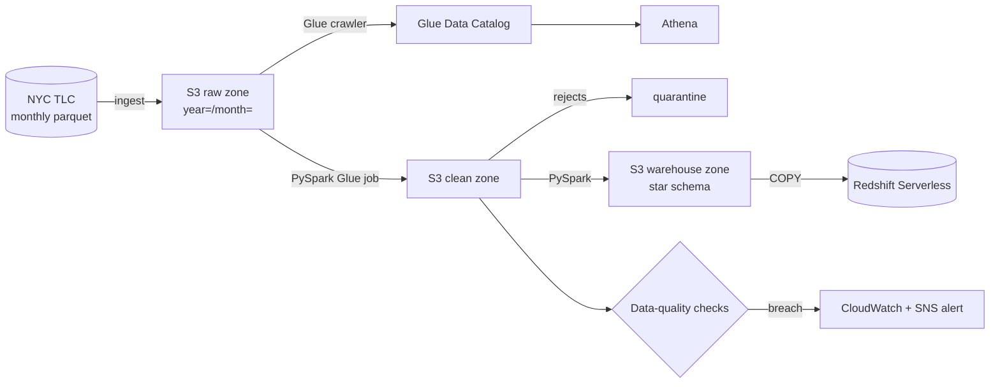
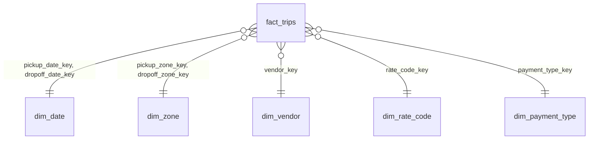

# NYC Taxi Data Lake on AWS

[](https://github.com/mohammadazam7/nyc-taxi-data-lake/actions/workflows/ci.yml)


[](LICENSE)

A batch pipeline that lands the public [NYC TLC trip records](https://www.nyc.gov/site/tlc/about/tlc-trip-record-data.page)
in an S3 data lake, cleans them with PySpark on AWS Glue, models a star schema in
Redshift Serverless, and alerts when data quality slips.

The same code runs on a laptop against local folders and in AWS against S3, so every
stage is testable without a cloud account.

> **Status:** under active development. Milestones 1–3 (ingest, clean, model) are complete; see the
> [roadmap](docs/ROADMAP.md) for what's next.

## Architecture



| Stage | What it does | Status |
|---|---|---|
| Ingest | Download month, conform schema drift, land in raw zone with a manifest | ✅ |
| Clean | Deduplicate, validate, quarantine bad rows | ✅ |
| Model | `fact_trips` + date, zone, payment, vendor, rate-code dimensions | ✅ |
| Quality | Row-count, null, range, referential and freshness checks | 🔜 |
| AWS | Terraform for S3, Glue, Athena, Redshift Serverless, CloudWatch, SNS | 🔜 |

## Quick start

```bash
git clone https://github.com/mohammadazam7/nyc-taxi-data-lake.git
cd nyc-taxi-data-lake
python -m venv .venv && source .venv/bin/activate
make install

# Real data from TLC (Jan–Mar 2024)
nyc-lake ingest 2024-01 2024-03

# Or fully offline with synthetic data that has realistic defects
nyc-lake ingest 2024-01 2024-03 --sample

# Clean the landed months (needs Java 17+ for Spark)
nyc-lake clean 2024-01 2024-03

# Build the star schema. It needs TLC's taxi_zone_lookup.csv in lake/raw/reference/;
# --sample-zones writes a placeholder there if it is missing.
nyc-lake model 2024-01 2024-03 --sample-zones
```

The lake is written under `./lake` (override with `NYC_LAKE_ROOT`):

```
lake/raw/yellow/year=2024/month=01/part-0000.parquet
lake/raw/yellow/year=2024/month=01/_manifest.json
lake/clean/yellow/pickup_date=2024-01-15/part-*.parquet
lake/clean/_runs/yellow/2024-01.json
lake/quarantine/yellow/year=2024/month=01/part-*.parquet
lake/warehouse/yellow/fact_trips/pickup_date=2024-01-15/part-*.parquet
lake/warehouse/yellow/dim_zone/part-*.parquet   (and the other dimensions)
lake/warehouse/_runs/yellow/2024-01.json
```

`nyc-lake clean` prints one line per month: rows in, rows kept, rows quarantined and the
count for each reason code.

## Clean stage rules

Each rejected row is tagged with the first rule it breaks. The codes are part of the
data contract, since quality checks and dashboards group by them.

| Code | Rejected when |
|---|---|
| `MISSING_TIMESTAMP` | pickup or dropoff time is null |
| `OUTSIDE_FILE_MONTH` | pickup falls outside the month the file covers |
| `DROPOFF_BEFORE_PICKUP` | dropoff is earlier than pickup |
| `TRIP_TOO_LONG` | trip lasted more than 24 hours |
| `NEGATIVE_AMOUNT` | fare or total amount is negative |
| `NEGATIVE_DISTANCE` | trip distance is negative |
| `BAD_PASSENGER_COUNT` | more than 9 passengers |
| `UNKNOWN_ZONE` | pickup or dropoff zone missing or outside 1–265 |
| `DUPLICATE` | an identical row was already kept |

Zones 264 and 265 ("unknown", "outside NYC") are valid TLC IDs and are kept.

## Star schema



The grain of `fact_trips` is one clean trip. It carries the trip's timestamps, duration,
distance, passenger count and the nine money columns. The Redshift DDL is in
[`sql/redshift/star_schema.sql`](sql/redshift/star_schema.sql); a test builds each table
with the Spark job and checks its columns and types against that file, because
`COPY` from Parquet matches columns by position.

- **Hash surrogate keys.** `dim_date` uses `yyyymmdd`. The other dimensions key on
  `xxhash64(dimension name, natural key)`, which is the same on every run, so a month of
  facts can be rebuilt on its own without a key lookup or a join to the dimensions.
- **Unknown members.** Every dimension has a row with code `-1`. A null code, or one
  missing from the TLC data dictionary, points there instead of leaving a dangling key.
- **SCD type 1.** The dimensions are small and rewritten in full on each run; nothing
  downstream needs old vendor or zone names.
- **Code lists in code.** Vendors, rate codes and payment types come from the TLC data
  dictionary and live in `model/reference.py`, so a change to them is reviewed like any
  other change. Zones come from TLC's lookup file.

## Design notes

- **Idempotent ingest.** Each partition has a manifest with a content hash. Re-running a
  month whose source hasn't changed is a no-op, so backfills are safe to retry.
- **Schema drift handled at the edge.** TLC files changed column names and types over the
  years (`Airport_fee` vs `airport_fee`, int vs double). Everything is conformed to one
  schema before it lands, so later stages see a single shape.
- **Atomic downloads.** Files stream to `.part` and are renamed on success; a killed
  download never looks complete.
- **Content-hash trip IDs.** TLC rows have no key, so `trip_id` is a SHA-256 of the
  whole row. Identical rows get identical IDs, which makes deduplication a window over
  one column and gives later stages a stable join key.
- **Re-runnable clean job.** The clean zone uses dynamic partition overwrite, so cleaning
  a month again replaces only that month's `pickup_date` partitions.
- **Synthetic data with real defects.** The generator injects duplicates, negative fares,
  dropoffs before pickups, out-of-month trips and unknown zones in roughly the
  proportions seen in TLC data, so cleaning and quality stages are tested against the
  problems they exist to solve.

## Development

```bash
make check   # ruff lint + format check, mypy --strict, pytest
```

CI runs the same checks on Python 3.11–3.13, the Spark tests on Java 17, and an
end-to-end smoke run that ingests, cleans and models three synthetic months. TLC's
download site is not reachable from CI, so all automated runs use the synthetic
generator and a placeholder zone lookup. Spark tests are
marked `spark` and skip automatically when PySpark isn't installed.

## Project layout

```
src/nyc_taxi_lake/
  cli.py            nyc-lake command
  config.py         settings from NYC_LAKE_* env vars
  months.py         YYYY-MM keys and Hive-style partitions
  schema.py         canonical yellow-trip schema + conform()
  ingest/
    tlc.py          downloader with retries and atomic writes
    raw_zone.py     idempotent partition writer + manifests
    sample.py       synthetic data generator
  clean/
    rules.py        validation rules and reason codes
    job.py          clean + quarantine writer
  model/
    reference.py    TLC code lists (vendor, rate code, payment type)
    dimensions.py   surrogate keys, code-list and date dimensions
    zones.py        dim_zone from the TLC zone lookup
    facts.py        fact_trips
    job.py          warehouse-zone writer
  spark.py          SparkSession factory (UTC, dynamic partition overwrite)
sql/redshift/       DDL for the warehouse tables
tests/
docs/ROADMAP.md
```

## License

MIT © Mohammad Azam
