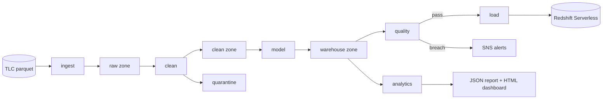

# Architecture

This document describes how the pipeline is put together, the contracts between its
stages, and how it behaves when a stage fails. The [README](../README.md) covers usage;
the [decision records](adr/) explain individual choices in more detail.

## Overview

The pipeline turns the monthly NYC TLC yellow-taxi trip files into a star schema and a
small set of reports. It is a batch system with a monthly cadence: TLC publishes each
month's file with a delay of roughly two months, so latency is measured in days and the
design optimises for correctness, re-runnability and cost rather than freshness.

Every stage is a `nyc-lake` subcommand. The same commands run on a laptop against local
folders, in the Docker image, and inside AWS Glue jobs against S3; there is no
cloud-only code path.

## Components

| Stage | Input | Output | Engine |
|---|---|---|---|
| ingest | TLC file or synthetic generator | `raw/<taxi>/year=/month=/` + `_manifest.json` | pyarrow |
| clean | raw zone | `clean/<taxi>/pickup_date=/`, `quarantine/`, `clean/_runs/` | PySpark |
| model | clean zone, zone lookup | `warehouse/<taxi>/<table>/`, `warehouse/_runs/` | PySpark |
| quality | raw, clean, quarantine and warehouse zones | `quality/<taxi>/<month>.json`, alerts | PySpark |
| load | warehouse zone in S3 | Redshift `taxi` schema | Redshift Data API |
| analytics | warehouse zone | `analytics/<taxi>/<start>_<end>.json` | Spark SQL |
| dashboard | analytics report, raw manifests | `analytics/<taxi>/<start>_<end>.html` | Python |

In AWS the lake is three S3 buckets (lake, artifacts, Athena results). Clean, model,
quality and load run as Glue 5.0 jobs that install this package as a wheel; a Step
Functions state machine chains them and an EventBridge Scheduler schedule starts it
monthly. Redshift Serverless holds the star schema for SQL clients, and the Glue Data
Catalog with Athena exposes every zone for ad hoc queries.

## Contracts between stages

Each zone is a contract, so a stage can be re-run, replaced or tested on its own.

- **Raw zone.** One Hive-style partition per month in the canonical schema
  (`schema.py`). Column-name and type drift between TLC file vintages is resolved at
  ingest, so later stages see one shape. The manifest records the source URI, a SHA-256
  of the conformed table and the row count.
- **Clean zone.** Rows that pass every rule, partitioned by `pickup_date`, with a
  deterministic `trip_id` (a SHA-256 of the row). Rejected rows go to the quarantine zone
  with the first reason code they break; the codes are part of the contract because
  quality checks group by them.
- **Warehouse zone.** `fact_trips` at one row per clean trip and five dimensions keyed by
  deterministic hash surrogates, so a month of facts can be rebuilt without reading the
  dimensions ([ADR 0002](adr/0002-hash-surrogate-keys.md)). Column order matches the
  Redshift DDL, which a test enforces, because `COPY` from Parquet maps by position.
- **Quality report.** One JSON document per month. The orchestrators treat a non-zero
  exit from `quality` as a failed month; `backfill` treats a passing report as a
  completed month.
- **Analytics report.** One JSON document per month range with every query's columns and
  rows as JSON scalars. The dashboard depends only on this file.

## Failure handling and re-runs

Every write is scoped to the month being processed, so any stage can be re-run for one
month without touching others.

| Failure | Behaviour |
|---|---|
| Download interrupted | The file streams to `.part` and is renamed on success, so a partial file is never read. |
| Ingest re-run, source unchanged | The manifest hash matches and the month is skipped. |
| Clean or model re-run | Dynamic partition overwrite replaces only that month's partitions. |
| Error-level quality breach | `quality` exits 1; the state machine and `nyc-lake run` stop before `load`, and SNS is notified. |
| `COPY` fails part way | The month's delete and copies are one transaction, so Redshift keeps the previous state. |
| Backfill stops part way | `backfill` skips months whose quality report passed, so re-running it resumes. |
| Glue job fails or loses tasks | EventBridge forwards failed runs and a CloudWatch alarm fires on failed tasks; both publish to SNS. |

## Security

Each Glue stage runs under its own IAM role that can read only its input zones and write
only its output zones. Buckets enforce TLS and server-side encryption and block public
access. The loader uses the Redshift Data API with IAM credentials, so there is no
database password and no inbound port. Redshift's `COPY` role can read only the
warehouse zone.

## Cost controls

Glue jobs default to G.1X workers and run once a month. The Redshift Serverless
workgroup has a configurable base capacity (8 to 512 RPU) and a daily RPU-hour usage
limit that deactivates the workgroup's queries when reached. Lifecycle rules expire
quarantine objects and Athena results. The monthly schedule is created disabled, so
applying the Terraform does not start spending.

## Limitations

- **Not yet run against real TLC data at scale.** All automated runs, including CI, use
  the synthetic generator because the TLC download site is not reachable from the CI
  environment. Row counts, runtimes and costs for real months are milestone 9.
- **Terraform not applied to an account.** The modules are validated and covered by
  plan-only tests against a mocked provider.
- **Ingest runs outside AWS.** It writes through the local filesystem; the raw zone is
  synced to S3 before a state machine execution.
- **Yellow taxis only.** Green, FHV and HVFHV files have different schemas and are not
  conformed.
- **Batch only.** There is no incremental or late-arriving-data path beyond re-running a
  month.
